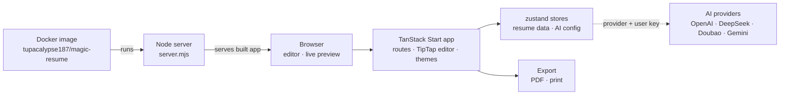

> **Fork notice:** This repo is a fork of the upstream
> [Magic Resume](https://github.com/JOYCEQL/magic-resume) project,
> with local additions on top:
>
> - **AI features** — provider configuration and AI-assisted editing;
>   see the [AI Features Guide](./AI-FEATURES-GUIDE.md).
> - **Lab deployment** — prebuilt image (`tupacalypse187/magic-resume`),
>   compose setup, and Kubernetes manifests; see the
>   [Deployment Guide](./deploy/README.md).
>
> Everything below is the upstream README unless noted otherwise.
<div align="center">

# ✨ Magic Resume ✨

[](https://opensource.org/licenses/Apache-2.0)


<a href="https://trendshift.io/repositories/13077" target="_blank"></a>

[简体中文](./README.zh-CN.md) | English

</div>

Magic Resume is a modern online resume editor that makes creating professional resumes simple and enjoyable. Built with TanStack Start and Framer Motion, it supports real-time preview, custom themes, and a comprehensive suite of AI-powered features.

## 📑 Table of Contents

- [🏗️ Architecture](#️-architecture)
- [📸 Screenshots](#-screenshots)
- [✨ Features](#-features)
- [🛠️ Tech Stack](#️-tech-stack)
- [🚀 Quick Start](#-quick-start)
- [📦 Build and Deploy](#-build-and-deploy)
- [🐳 Docker Deployment](#-docker-deployment)
- [📝 License and Commercial Use](#-license-and-commercial-use)
- [🗺️ Roadmap](#️-roadmap)
- [📈 Star History](#-star-history)
- [📞 Contact](#-contact)
- [🌟 Support](#-support)
- [❤️ Sponsors](#️-sponsors)

## 🏗️ Architecture

Magic Resume is a TanStack Start (React + Vite) app: the editor and its live
preview run in the browser, resume and AI settings live in zustand stores,
and AI polish calls whichever provider the user configured with their own
API key. This fork packages the built app as a single Docker image that a
small Node server serves in the lab.



| Piece | Where | Role |
|---|---|---|
| Web app | `src/routes`, `src/app`, `src/components` | TanStack Router/Start pages — landing, dashboard, editor — with a TipTap rich-text editor, themeable live preview, and Framer Motion |
| State | `src/store` | zustand stores for the resume data and the AI configuration (`ai-config-storage`) |
| AI features | `src/config/ai.ts`, `src/hooks/useAIConfiguration.tsx`, `src/lib/server/` | Provider definitions for OpenAI, DeepSeek, Doubao, and Gemini; AI polish/generation calls go out with the user's own API keys |
| Export | `src/components`, `src/lib` | PDF and print flows (html2pdf.js; Puppeteer/Chromium bundled for rendering) |
| Packaging | `Dockerfile`, `docker-compose.yml` | Multi-stage pnpm build into a slim Node runner serving `dist` via `server.mjs`; published as `tupacalypse187/magic-resume` by the docker-publish workflow and run in the lab with docker compose |

**Main flow:** open a resume → edit in TipTap with the preview updating
live → optionally run AI polish against the configured provider → export to
PDF. In the lab the whole app is just the one container.

## 📸 Screenshots


## ✨ Features

### 📝 Core Editor
- 🚀 Built with TanStack Start
- 💫 Smooth animations (Framer Motion)
- 🎨 Custom theme support with 12+ preset colors
- 📱 Responsive design with mobile workbench
- 🌙 Dark mode
- 📤 Export to PDF, JSON, and Markdown
- 🔄 Real-time preview (what you see is what you get)
- 💾 Auto-save with file system sync
- 🔒 100% local storage — your data never leaves your device

### 🎯 Templates
- 📄 8 professionally designed templates: Classic, Two Column, Section Title BG, Timeline, Minimalist, Elegant, Creative, Editorial
- 🔄 Switch templates instantly without losing content
- 📐 Per-template spacing and layout controls

### 🤖 AI-Powered Features

Magic Resume integrates deeply with AI to help you build the best possible resume:

#### 🔍 AI Resume Review
- Full resume analysis with a **0–100 score** across 5 categories:
  - **Content Quality** — writing clarity, impact, action verbs
  - **ATS Compatibility** — applicant tracking system optimization
  - **Keywords** — industry-relevant terms and skills
  - **Formatting** — consistency, completeness, structure
  - **Completeness** — missing sections, gaps, areas needing detail
- **One-click apply** — accept individual fixes or batch-apply selected suggestions
- **Undo support** — revert any applied fix with a single click

#### 💬 AI Chat Assistant
- Persistent chat panel with **full resume context** — the AI always knows your resume
- Conversational refinement — discuss career strategy, brainstorm improvements, ask for rewrites
- **Saved sessions** — chat history persists across page reloads, organized by resume
- **Quick actions** — one-tap prompts: "Review my resume", "Improve experience", "Suggest keywords", "Rewrite summary"

#### ✏️ Section-Level AI Actions
- **Sparkles button** in the section editor header opens AI actions for just that section
- **Review Section** — focused analysis of a single section
- **Improve Writing** — AI rewrites for impact and professionalism
- **Add Keywords** — get industry-specific keyword suggestions

#### 🎨 AI Style Suggestions
- AI analyzes your resume content and suggests optimal **theme colors, fonts, spacing, and template**
- Optional target role input — get suggestions tailored to your industry
- One-click apply style changes

#### 📝 AI Polish (Original)
- Select any rich text content and let AI rewrite it for maximum impact
- Streaming response with real-time preview
- Custom instructions support (e.g., "use more technical terms", "highlight metrics")

#### ✅ AI Grammar Check
- Detects typos and punctuation errors
- Highlights errors directly in the resume preview
- Accept or dismiss each suggestion individually

#### 📄 AI PDF Import
- Upload a PDF resume and Gemini Vision extracts structured data automatically
- Maps extracted content into the editor for further refinement

### 🤖 Supported AI Providers

| Provider | Best For |
|----------|----------|
| 🟢 **OpenAI** (or compatible) | General purpose, any endpoint |
| 🟣 **Anthropic (Claude)** | Nuanced writing, detailed feedback |
| 🔵 **Gemini** | Fast, free tier, PDF import |
| 🟡 **DeepSeek** | Cost-effective alternative |
| 🔴 **Doubao (Volcengine)** | Chinese-language optimization |

## 🛠️ Tech Stack

- **Framework**: TanStack Start
- **Language**: TypeScript
- **Animation**: Framer Motion
- **Editor**: Tiptap
- **Styling**: Tailwind CSS + Shadcn/ui
- **State**: Zustand (with persistence)
- **Icons**: Lucide React + Remix Icons
- **AI**: Multi-provider (OpenAI, Anthropic, Gemini, DeepSeek, Doubao)
- **Markdown**: Streamdown (animated streaming rendering)
- **Export**: Puppeteer (server-side PDF), html2canvas

## 🚀 Quick Start

1. Clone the project

```bash
git clone git@github.com:JOYCEQL/magic-resume.git
cd magic-resume
```

2. Install dependencies

```bash
pnpm install
```

3. Start development server

```bash
pnpm dev
```

4. Open browser and visit `http://localhost:3000`

5. Configure AI — go to **Dashboard → AI Config** and enter your API key for any supported provider

## 📦 Build and Deploy

```bash
pnpm build
```

### AI provider networking

Cloudflare Workers use the platform's native `fetch` and do not need an application-level proxy. For Node.js or Docker deployments in regions that cannot directly reach OpenAI, Gemini, or Anthropic, set `AI_PROXY_URL`. `HTTPS_PROXY` and `HTTP_PROXY` are also supported as fallbacks.

```bash
AI_PROXY_URL=http://127.0.0.1:7890
```

DeepSeek, Qwen, and Doubao continue to use a direct connection.


## 🐳 Docker Deployment

### Prebuilt image

A prebuilt image is published to Docker Hub (stateless, no secrets baked in):

```
tupacalypse187/magic-resume:2.0.6-ai
```

```bash
docker run -d -p 3000:3000 \
  -v "$PWD/ai-config.json:/app/ai-config.json:ro" \
  --restart always \
  tupacalypse187/magic-resume:2.0.6-ai
```

For Kubernetes / MicroK8s deployment, TLS setup, and the full tag structure, see **[deploy/README.md](./deploy/README.md)**.

### 🐳 Docker Compose

1. Ensure you have Docker and Docker Compose installed

2. Run the following command in the project root directory:

```bash
docker compose up -d
```

This will:

- Automatically build the application image
- Start the container in the background

### Build from source (two-stage build for fast rebuilds)

The Docker setup uses a base image for dependencies and a separate app image for source code:

**One-time (or when dependencies change):**
```bash
docker compose build base
```

**Every code change:**
```bash
docker compose up -d --build web
```

**Full rebuild:**
```bash
docker compose build base && docker compose up -d --build web
```

### AI Configuration

Mount your AI config file as a volume:

```yaml
volumes:
  - ./ai-config.json:/app/ai-config.json:ro
```

Example `ai-config.json`:
```json
{
  "selectedModel": "openai",
  "openaiApiKey": "sk-...",
  "openaiModelId": "gpt-4o",
  "openaiApiEndpoint": "https://api.openai.com/v1"
}
```

## 📝 License and Usage Restrictions

The source code of this project is released under the **Apache 2.0** license with an additional **non-commercial use restriction**:

- **Free for Personal Use**: Free to use purely for personal, non-commercial purposes (e.g., personal learning, creating your own resume).
- **Commercial Use Prohibited**: The project may not be used for any commercial purpose, including providing it as a paid or profit-generating service (such as SaaS/PaaS), enterprise commercial operations, resale, or secondary commercial development, **regardless of whether the source code has been modified**.

Please see the [LICENSE](LICENSE) file for detailed terms.

## 🗺️ Roadmap

- [x] AI-assisted writing (polish)
- [x] Multi-language support (English / Chinese)
- [x] AI Resume Review with scoring
- [x] AI Chat Assistant with saved sessions
- [x] Section-level AI actions
- [x] AI Style and template suggestions
- [x] AI Grammar check
- [x] AI PDF import
- [x] Custom AI model support (5 providers)
- [x] Auto one page
- [x] Docker deployment with fast rebuilds
- [ ] Support for more resume templates
- [x] Support for more export formats
- [x] Import PDF, Markdown, etc.
- [x] Custom model
- [x] Auto one page
- [ ] Online resume hosting

## 📈 Star History

<a href="https://star-history.com/#JOYCEQL/magic-resume&Date">
 <picture>
   <source media="(prefers-color-scheme: dark)" srcset="https://api.star-history.com/svg?repos=JOYCEQL/magic-resume&type=Date&theme=dark" />
   <source media="(prefers-color-scheme: light)" srcset="https://api.star-history.com/svg?repos=JOYCEQL/magic-resume&type=Date" />
   
 </picture>
</a>

## 📞 Contact

You can follow the latest updates via:

- Author: Siyue
- X: @GuangzhouY81070
- Discord: Join our community [discord.gg/9mWgZrW3VN](https://discord.gg/9mWgZrW3VN)
- Email: 18806723365@163.com


- Project Homepage: [github.com/JOYCEQL/magic-resume](https://github.com/JOYCEQL/magic-resume)

## 🌟 Support

If you find this project helpful, please give it a star ⭐️

## ❤️ Sponsors

<div align="center">
  <h3>Sponsors</h3>
  <p>If you sponsored this project but are not listed here, please contact me.</p>
  <p>
    <a href="https://github.com/yj147">
      
    </a>
    <a href="https://github.com/someone1128">
      
    </a>
    <!-- Add more sponsors here:
    <a href="https://github.com/<username>">
      .png?size=40" width="40" height="40" alt="@<username>" />
    </a>
    -->
  </p>
</div>
